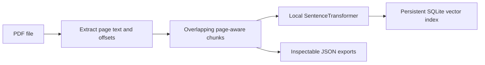
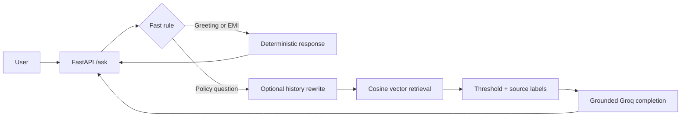

# Architecture

## Ingestion

## Question answering

The vector store uses cosine distance (`0` is closest); the retriever rejects
results above the configured distance threshold. Citations are built from the
chunk's source filename and overlapping PDF page metadata.
